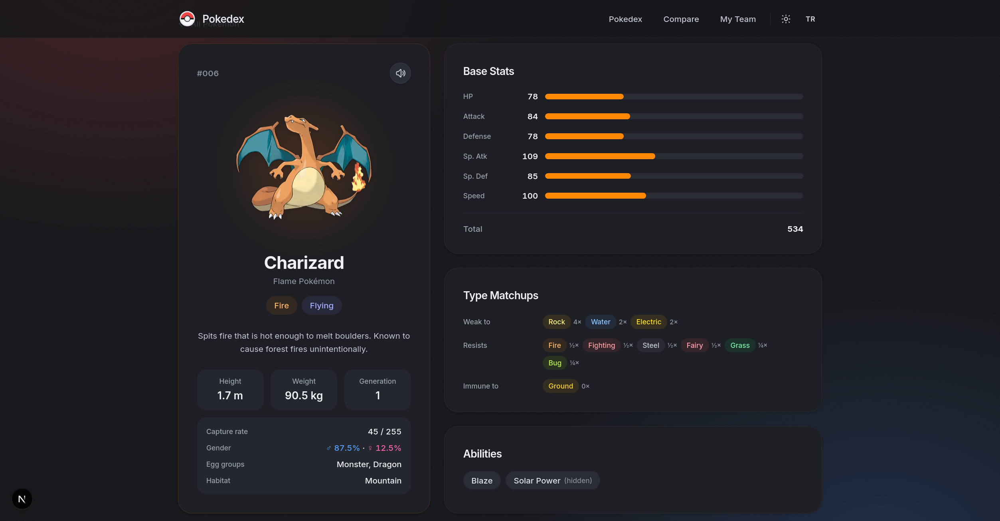
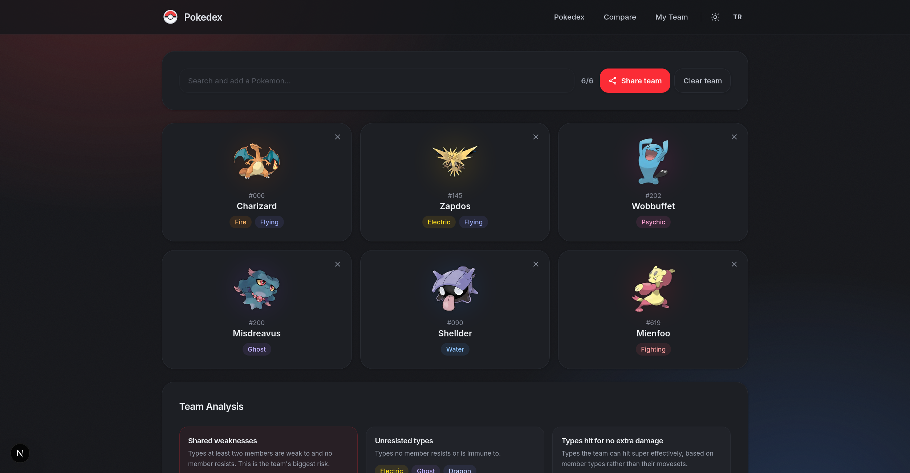
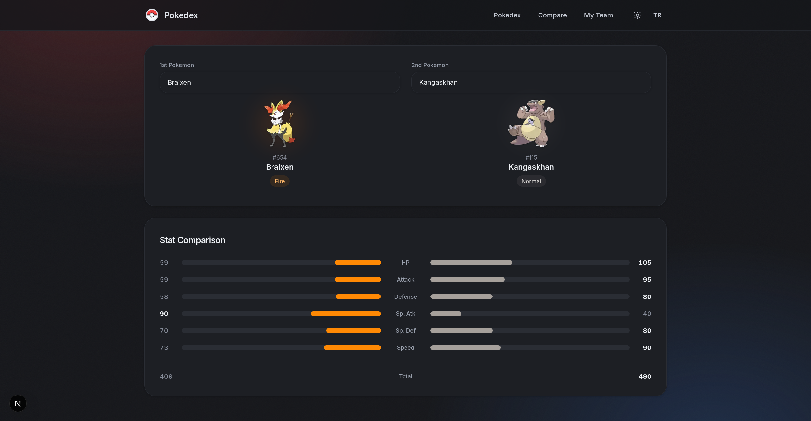

# Pokedex

> A modern web encyclopedia for the Pokemon universe.

Pokedex brings every species from the first nine generations together in a single, fast interface. It serves as a complete reference for anyone exploring the franchise — from a quick lookup of a Pokemon's types and stats to deeper questions like how an evolution line branches, which types a certain pairing is weak to, or where a Pokemon can be encountered in the games. All data is sourced live from [PokeAPI](https://pokeapi.co) and rendered with Next.js, TypeScript, and Tailwind CSS, so the entire application runs without a database or any server-side state and deploys to Vercel as-is.

**[View the live application here.](https://pokedex-batuhanmeral.vercel.app/tr)**

## Features

- **All Pokemon** — every species from Gen 1 through Gen 9 (1025 Pokemon), listed as type-colored cards with instant client-side search by name or number.
- **Filters** — filter the grid by any of the 18 types and/or by generation, with "load more" pagination.
- **Detail page** (`/[locale]/pokemon/[id]`) — official artwork, types, height/weight/generation, abilities, and base stats as visual bars, plus:
  - **Type matchups** — combined defensive multipliers (4×/2×/½×/¼×/0×) computed from both types' damage relations.
  - **Evolution chain** — clickable, branching chains included, with evolution conditions (level, stone, trade, happiness…) shown on each stage.
  - **Alternate forms** — mega/Gigantamax/regional varieties linked as cards.
  - **Species info** — capture rate, gender ratio, egg groups, habitat, and legendary/mythical badges.
  - **Moves** — level-up move table (from the version group with the richest data) and a collapsible TM/TR list.
  - **Encounter locations** — where the Pokemon can be caught in the wild, listed per location with the game versions it appears in.
  - **Cry** — a speaker button plays the Pokemon's cry.
- **Compare** (`/[locale]/compare`) — pick two Pokemon via searchable comboboxes and compare their base stats side by side; the higher value is highlighted.
- **Team builder** (`/[locale]/team`) — assemble a team of up to 6 Pokemon with a searchable combobox. The team lives entirely in the URL query string, so a single "Share team" click copies a link that reproduces the exact team — no database needed.
  - **Team analysis** — the panel below the slots answers where the team is exposed: shared weaknesses (types at least two members are weak to and none resists), unresisted types, types the team cannot hit super effectively, and a per-type grid of how many members are weak to or resist each of the 18 attacking types. Recomputed instantly on every change, with no extra requests.
- **Random Pokemon** — a button next to the filters jumps to a random Pokemon's detail page.
- **Dark mode** — system-aware theme with a manual toggle, implemented with `next-themes` and Tailwind's class-based dark variant. The dark palette sits on a blue-tinted grey rather than black, over a fixed aurora layer (two soft radial glows plus a fine grain) that is pure CSS — no JavaScript and no animation.
- **i18n (TR/EN)** — locale-prefixed routes (`/tr`, `/en`) with middleware-based detection (cookie → `Accept-Language` → default) and a language switcher in the navbar.

## Tech Stack

| Category | Technology |
| :--- | :--- |
| Framework | [Next.js 16](https://nextjs.org) (App Router) |
| Language | [TypeScript](https://www.typescriptlang.org) |
| Styling | [Tailwind CSS 4](https://tailwindcss.com) |
| Data source | [PokeAPI](https://pokeapi.co) |
| Theming | [next-themes](https://github.com/pacocoursey/next-themes) |
| Deployment | [Vercel](https://vercel.com) |

## Development

Requires Node.js `^22.12.0 || ^24 || >=26` (declared in `engines`); CI uses the version pinned in `.nvmrc`.

```bash
npm install
npm run dev    # http://localhost:3000
npm run build  # production build
```

### Checks

```bash
npm test                            # unit tests, single run (Vitest)
npx vitest run lib/pokeapi.test.ts  # a single test file
npm run test:watch                  # watch mode
npm run lint                        # ESLint (flat config)
npm run typecheck                   # tsc --noEmit
npm run check                       # lint + typecheck + tests with coverage thresholds
npm run smoke                       # manual smoke check; run `npm run build` first
```

Tests never touch the network: PokeAPI is mocked and unmocked `fetch` calls fail the test.

## CI and security

GitHub Actions runs two workflows. Every action is pinned to a commit SHA and every scanner image to a digest.

| Check | Workflow | Runs on | What it does |
| :--- | :--- | :--- | :--- |
| `build` | `ci.yml` | push to `main`, pull requests | `npm ci`, lint, typecheck, unit tests with coverage thresholds, `next build` (Node from `.nvmrc`) |
| `scan` | `security.yml` | push to `main`, pull requests, monthly, manual | gitleaks (full history), Semgrep (TypeScript, React, Next.js, GitHub Actions rules), zizmor (workflow audit), dependency review on PRs |

Both checks are required on `main` by a repository ruleset. Blocking thresholds: any gitleaks finding, Semgrep `ERROR`/`WARNING`, zizmor `medium` and above, newly added dependencies with `high`/`critical` advisories.

## Deploy

Connect the repository to Vercel — no environment variables or extra configuration needed.

## Screenshots

| Screenshots |
| :---: |
| **Home — search, type/generation filters and the Pokemon grid** |
|  |
| **Detail page — base stats, type matchups and species info** |
|  |
| **Team builder — six slots and the team analysis panel** |
|  |
| **Compare — side-by-side base stats** |
|  |

## License

[MIT](LICENSE)
