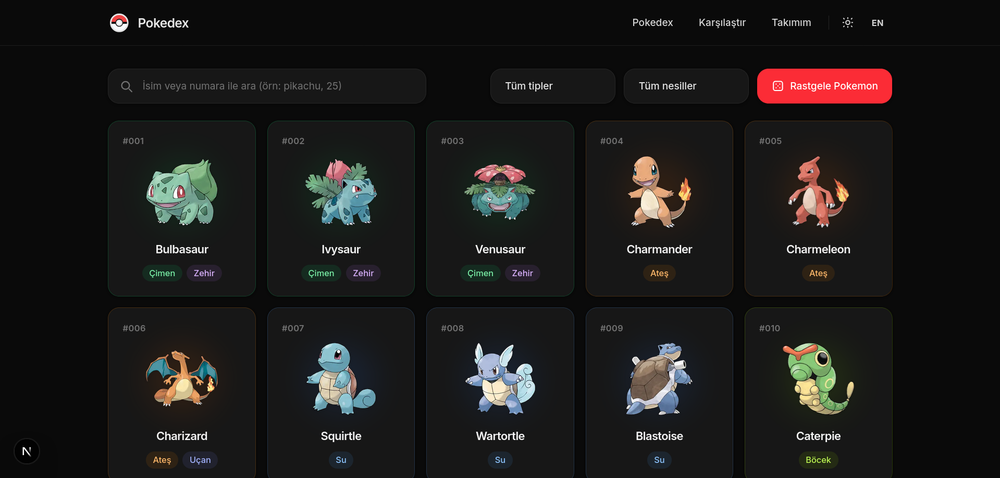

# Pokedex

> A modern web encyclopedia for the Pokemon universe.

Pokedex brings every species from the first nine generations together in a single, fast interface. It serves as a complete reference for anyone exploring the franchise — from a quick lookup of a Pokemon's types and stats to deeper questions like how an evolution line branches, which types a certain pairing is weak to, or where a Pokemon can be encountered in the games. All data is sourced live from [PokeAPI](https://pokeapi.co) and rendered with Next.js, TypeScript, and Tailwind CSS, so the entire application runs without a database or any server-side state and deploys to Vercel as-is.

**[View the live application here.](https://pokedex-batuhanmeral.vercel.app/tr)**

## Features

- **All Pokemon** — every species from Gen 1 through Gen 9 (1025 Pokemon), listed as type-colored cards with instant client-side search by name or number.
- **Filters** — filter the grid by any of the 18 types and/or by generation, with "load more" pagination.
- **Detail page** (`/[locale]/pokemon/[id]`) — official artwork, types, height/weight/generation, abilities, and base stats as visual bars, plus:
  - **Type matchups** — combined defensive multipliers (4×/2×/½×/¼×/0×) computed from both types' damage relations.
  - **Evolution chain** — clickable, branching chains included, with evolution conditions (level, stone, trade, happiness…) shown on each stage.
  - **Alternate forms** — mega/Gigantamax/regional varieties linked as cards.
  - **Species info** — capture rate, gender ratio, egg groups, habitat, and legendary/mythical badges.
  - **Moves** — level-up move table (from the version group with the richest data) and a collapsible TM/TR list.
  - **Encounter locations** — where the Pokemon can be caught in the wild, listed per location with the game versions it appears in.
  - **Cry** — a speaker button plays the Pokemon's cry.
- **Compare** (`/[locale]/compare`) — pick two Pokemon via searchable comboboxes and compare their base stats side by side; the higher value is highlighted.
- **Team builder** (`/[locale]/team`) — assemble a team of up to 6 Pokemon with a searchable combobox. The team lives entirely in the URL query string, so a single "Share team" click copies a link that reproduces the exact team — no database needed.
- **Random Pokemon** — a button next to the filters jumps to a random Pokemon's detail page.
- **Dark mode** — system-aware theme with a manual toggle, implemented with `next-themes` and Tailwind's class-based dark variant.
- **i18n (TR/EN)** — locale-prefixed routes (`/tr`, `/en`) with middleware-based detection (cookie → `Accept-Language` → default) and a language switcher in the navbar.

## Tech Stack

| Category | Technology |
| :--- | :--- |
| Framework | [Next.js 15](https://nextjs.org) (App Router) |
| Language | [TypeScript](https://www.typescriptlang.org) |
| Styling | [Tailwind CSS 4](https://tailwindcss.com) |
| Data source | [PokeAPI](https://pokeapi.co) |
| Theming | [next-themes](https://github.com/pacocoursey/next-themes) |
| Deployment | [Vercel](https://vercel.com) |

## Development

```bash
npm install
npm run dev    # http://localhost:3000
npm run build  # production build
npm run smoke  # build + start + curl smoke test
```

## Deploy

Connect the repository to Vercel — no environment variables or extra configuration needed.

## Screenshots

| Screenshots |
| :---: |
| **Home — search, filters and the Pokemon grid** |
|  |
| **Detail page — stats, type matchups, evolutions and moves** |
|  |
| **Compare — side-by-side base stats** |
|  |

## License

[MIT](LICENSE)
